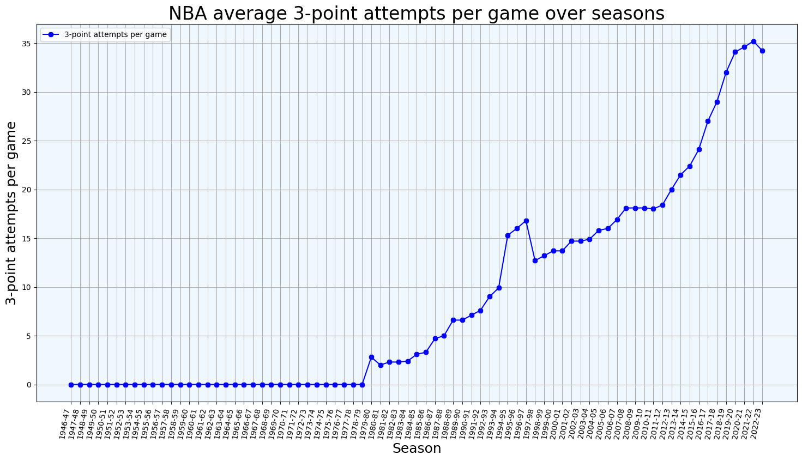
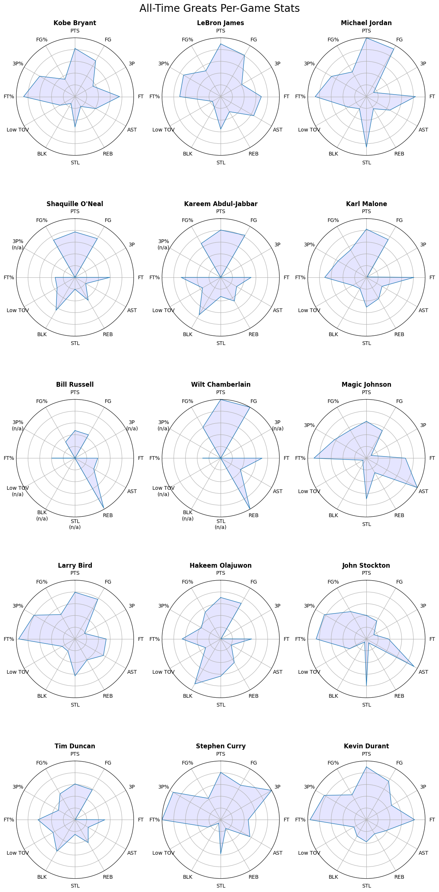

# NBA Stats Analysis

An exploratory analysis of **68 NBA regular seasons (1955-56 to 2022-23)** of player statistics scraped from [Basketball-Reference](https://www.basketball-reference.com/). It looks at how the league has changed over time (player age, roster sizes, three-point shooting, scoring) and who leads the all-time statistical categories. It ends with a radar-chart comparison of 15 all-time greats.

> **A personal project.** I built this out of my own interest in basketball, after coming across an [NBA player-stats dataset on data.world](https://data.world/etocco/nba-player-stats). I based my scraper on the approach used there and expanded it into a full analysis.

| | |
|---|---|
| 📓 **Notebook** | [`nba_stats_analysis.ipynb`](nba_stats_analysis.ipynb), the full analysis with code, charts and commentary ([view on nbviewer](https://nbviewer.org/github/stef4k/NBA-Stats-Analysis/blob/main/nba_stats_analysis.ipynb) if GitHub doesn't render it) |
| 📊 **Presentation** | [`Presentation.pdf`](Presentation.pdf), a 5-minute summary of the main insights |
| 🗂️ **Data** | [`data/`](data/), a snapshot of the scraped tables, so the notebook runs without scraping again |

**Tools:** Python · pandas · matplotlib · seaborn · scikit-learn · Jupyter

## Key findings

- **The league got younger.** Average player age peaked at 27.7 in 1999-00 and hit its all-time low of 25.6 in 2020-21. The share of players under 24 grew from 14.5% (1994-95) to 37.4% (2020-21). Part of this is the faster style of play; part is roster rules such as two-way contracts, introduced in 2017-18.
- **Rosters grew nearly six-fold.** The number of players per season rose from 92 to more than 500. Most of the growth comes from league expansion, from 8 teams to 30. On top of that came two-way contracts, and a one-off peak of 605 players in 2021-22 caused by COVID-19 hardship signings.
- **The three-point revolution.** Teams went from zero three-point attempts before 1979-80 to 35.2 per game in 2021-22. The chart also shows the bump of 1994-97, when the league temporarily moved the line closer.
- **Scoring is back.** League scoring fell to 91.6 points per game in 1998-99, its lowest in the shot-clock era, and climbed back to 114.7 by 2022-23. That is still below the 118.8 of 1961-62.
- **GOAT comparison.** On career totals, Kareem Abdul-Jabbar and LeBron James have the most complete profiles. On per-game numbers, Michael Jordan does.



<details>
<summary><b>Radar comparison of 15 all-time greats (per-game stats)</b></summary>



Each axis is min-max scaled against all players with at least 300 games and 600 field-goal attempts. On `Low TOV`, further out means fewer turnovers. `n/a` marks stats that were not recorded during a player's career.
</details>

## How it works

1. **Scraping.** `pandas.read_html` reads, for every season, Basketball-Reference's per-game and season-totals tables. It also reads the MVP list, the championship leaders and the league averages by season. Player links are kept so every row carries Basketball-Reference's unique player ID. Requests are spaced 5 seconds apart, and every table is cached as CSV in `data/`.
2. **Cleaning.**
   - **One row per player per season.** Traded players appear once per team plus once combined; only the combined row is kept.
   - **Players matched by ID, not name.** Otherwise namesakes get merged, such as the two Eddie Johnsons who played in the 1980s.
   - **Stats used only from their official start season:** steals and blocks from 1973-74, turnovers from 1977-78, games started from 1981-82. Seasons before that are left empty, not set to zero.
3. **Analysis.**
   - Trends over time, plus single-season and career leaderboards.
   - Career numbers are summed from exact season totals, so they match the official career figures. Career percentage leaders use Basketball-Reference's own minimums: 2,000 made field goals, 250 made threes, 1,200 made free throws.
   - The radar charts scale each stat between the lowest and highest value among qualifying players and flip turnovers so that fewer is better.

## Limitations

- **Coverage.** Regular season only, NBA only (no ABA), starting in 1955-56. Careers that began earlier are missing their first seasons.
- **Era effects.** Stats that weren't recorded yet show as `n/a`, which makes early greats such as Bill Russell and Wilt Chamberlain look smaller on the radar charts. Per-game numbers are not adjusted for pace.
- **Radar charts are a visual comparison, not a ranking.** The shape depends on which stats are included and on the comparison pool. Career totals also reward longevity.
- **Championships.** Basketball-Reference's championship table only lists players with 3 or more titles. The counts for the five greats with fewer titles are entered by hand.
- **Snapshot.** The data was scraped in October 2026 and fixed to seasons up to 2022-23, the last season available when the project was first built.

## Run it yourself

```bash
git clone https://github.com/stef4k/NBA-Stats-Analysis.git
cd NBA-Stats-Analysis
python -m venv .venv
source .venv/bin/activate          # Windows: .venv\Scripts\activate
pip install -r requirements.txt jupyterlab
jupyter lab nba_stats_analysis.ipynb
```

The notebook reads the saved tables from `data/`. To scrape fresh data, delete that folder first. A full scrape takes about 12 minutes because of the delay between requests.

## Repository structure

```
├── nba_stats_analysis.ipynb   # full analysis
├── Presentation.pdf           # summary slides
├── data/                      # scraped Basketball-Reference tables (CSV snapshot)
├── images/                    # exported figures
└── requirements.txt           # pinned Python dependencies
```

## Project history

First built in 2023. Revisited in 2026 to make it reproducible, with a saved data snapshot and pinned dependencies. The revision also fixed issues found in a review:

- players are now matched by ID instead of name;
- career totals come from exact season totals rather than rounded per-game averages;
- turnovers count against a player in the radar charts;
- stats from before official tracking are no longer treated as zero.

## Data source

All statistics come from [Basketball-Reference.com](https://www.basketball-reference.com/) (© Sports Reference LLC). The scraped tables are included only to make this non-commercial personal project reproducible.
